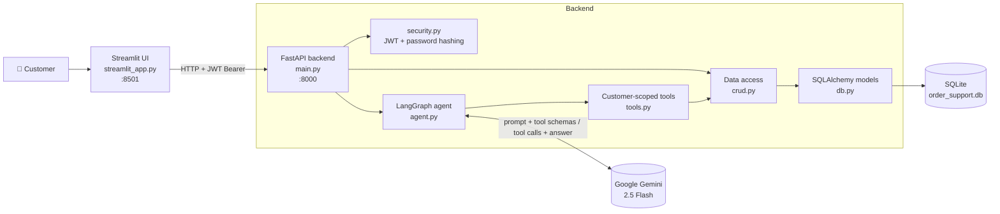
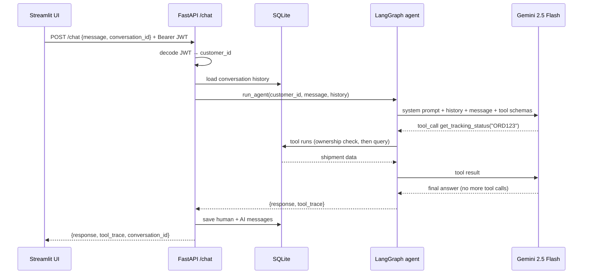
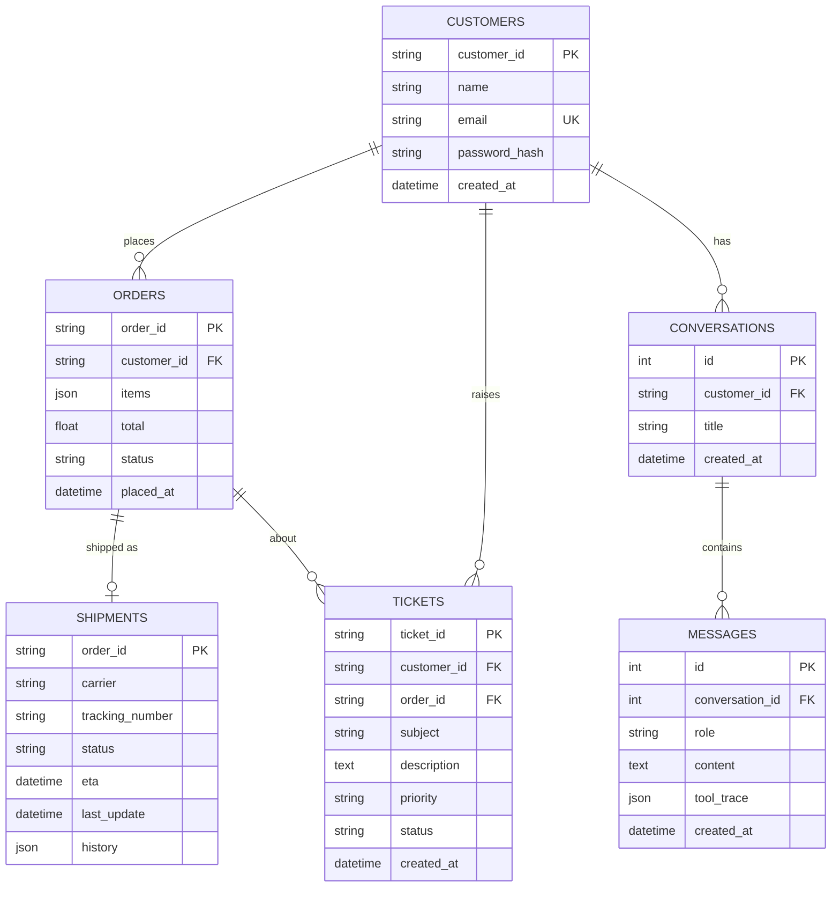

# 📦 Order & Delivery Support Agent

An AI customer-support agent for an e-commerce delivery platform. Customers
log in and chat in plain language: "Where is my order?", "My item arrived
broken", "Can I cancel this?". A **LangGraph ReAct agent** powered by
**Google Gemini 2.5 Flash** decides which backend tools to call (look up
orders, check tracking, open tickets, cancel orders) and replies with a
grounded answer.

It is a full working stack: a **FastAPI** backend with **JWT
authentication**, a **SQLite** database through **SQLAlchemy**, saved
multi-turn conversations, and a **Streamlit** chat UI.

---

## Table of contents
- [Features](#features)
- [Tech stack](#tech-stack)
- [Architecture](#architecture)
- [How the agent works](#how-the-agent-works)
- [Agent tools](#agent-tools)
- [Data model](#data-model)
- [Security design](#security-design)
- [API reference](#api-reference)
- [Getting started](#getting-started)
- [Project structure](#project-structure)
- [What the agent knows (and doesn't)](#what-the-agent-knows-and-doesnt)
- [Known limitations](#known-limitations)
- [Roadmap](#roadmap)

---

## Features
- 💬 **Natural-language support chat** for order status, delivery
  tracking, refunds, cancellations, and raising issues.
- 🤖 **Tool-calling agent**: the LLM chooses which tools to call, reads the
  results, and loops until it has an answer (the ReAct pattern).
- 🔐 **Real authentication**: register and log in with email and password.
  Passwords are hashed with PBKDF2-SHA256, and sessions use JWT bearer tokens.
- 🛡️ **Per-customer data isolation**: the agent can only see the logged-in
  customer's orders and tickets, even if a prompt asks for someone else's.
- 🧠 **Conversation memory**: chats are saved in the database, and past
  turns are passed back to the agent so follow-up questions work.
- 🔧 **Tool trace**: every answer shows which tools the agent used
  (e.g. `🔧 get_order_details, get_tracking_status`).
- 🖥️ **Streamlit UI** with login/register, a conversation sidebar, and chat.

---

## Tech stack

| Layer | Technology | Why |
|---|---|---|
| LLM | **Google Gemini 2.5 Flash** (`langchain-google-genai`) | Fast, inexpensive, good at tool calling; `temperature=0` for consistent answers |
| Agent framework | **LangGraph** (`StateGraph`, `ToolNode`) | The think → act → observe loop is an explicit graph, not a black box |
| Tools | **LangChain** `@tool` + `bind_tools` | Standard tool schema that the LLM can call |
| Backend API | **FastAPI** + **Uvicorn** | Async Python API, Pydantic validation, auto-generated docs at `/docs` |
| Validation | **Pydantic** + `email-validator` | Request/response models, email checking |
| Database | **SQLite** via **SQLAlchemy ORM** | No setup needed; switching to PostgreSQL only needs `DATABASE_URL` |
| Auth | **PyJWT** (HS256) + PBKDF2-HMAC-SHA256 (Python stdlib) | Stateless sessions; no extra crypto dependencies |
| Frontend | **Streamlit** + `requests` | Quick chat UI that talks to the API over HTTP |
| Config | **python-dotenv** | Loads secrets from `.env` |

---

## Architecture



**Layers, top to bottom**

1. **Presentation**: `streamlit_app.py`. Login/register screens and the
   chat window. It holds only the JWT token and sends every request to the API.
2. **API**: `main.py`. Checks the JWT on each request, loads the
   conversation history, runs the agent, and saves the new messages.
3. **Agent**: `agent.py`. A LangGraph state machine around Gemini.
4. **Tools**: `tools.py`. Seven functions the LLM can call. They're
   created fresh for each request around the authenticated customer ID.
5. **Data access**: `crud.py`. Every database read and write goes through here.
6. **Persistence**: `db.py`. SQLAlchemy models and the database engine.

### Request lifecycle (one chat message)



---

## How the agent works

The agent is an explicit **ReAct loop** built with LangGraph:

```
START ──► agent (Gemini decides) ──► tool calls? ──yes──► tools (run them) ──┐
              ▲                          │                                    │
              │                          no                                   │
              │                          ▼                                    │
              │                         END (final answer)                    │
              └───────────────────────────────────────────────────────────────┘
```

- **`agent` node**: calls Gemini, which has the tools bound to it. Gemini
  either asks for one or more tool calls or writes the final answer.
- **`tools` node**: LangGraph's `ToolNode` runs the requested tools and adds
  their results to the conversation as `ToolMessage`s.
- **Conditional edge**: if the last message has tool calls, go to `tools`;
  otherwise stop.
- **State**: a list of messages (`AgentState`) that grows as the loop runs.
- **Memory**: earlier turns are loaded from the `messages` table and replayed
  as `HumanMessage` / `AIMessage`. Only the final text of each past turn is
  kept, not the intermediate tool calls.
- **System prompt rules**: only use the logged-in customer's data, call only
  the tools that are needed, open a ticket rather than promise something the
  agent can't do, and be concise and empathetic without mentioning internal
  tool names.

---

## Agent tools

All tools are defined in `tools.py` inside `build_tools(customer_id)`.

| Tool | Type | What it does |
|---|---|---|
| `get_my_orders()` | read | Lists the customer's orders with status, total, and date placed |
| `get_order_details(order_id)` | read | Items, total, and status for one order |
| `get_tracking_status(order_id)` | read | Carrier, tracking number, ETA, and tracking events |
| `get_my_tickets()` | read | The customer's past and open support tickets |
| `create_support_ticket(order_id, subject, description)` | **write** | Opens a ticket (`T1025`, `T1026`, …) with status `OPEN` |
| `check_refund_eligibility(order_id)` | read | Rule-based: `DELIVERED` → eligible; `PROCESSING`/`SHIPPED` → not yet (cancellation may apply) |
| `request_cancellation(order_id)` | **write** | Cancels the order unless it is `SHIPPED` or `DELIVERED` |

Every tool that takes an `order_id` first checks that the order belongs to
the authenticated customer.

---

## Data model



Order statuses: `PROCESSING`, `SHIPPED`, `DELIVERED`, `CANCELLED`.

---

## Security design

| Concern | How it's handled |
|---|---|
| **Data isolation / prompt injection** | The `customer_id` comes from the verified JWT and is fixed inside the tools when they're created. The LLM never supplies a customer ID, and every tool re-checks order ownership, so "show me customer C2001's orders" can't work. |
| **Password storage** | PBKDF2-HMAC-SHA256 with a random 16-byte salt and **600,000 iterations** (OWASP recommendation). Hashes are stored as `pbkdf2_sha256$<iterations>$<salt>$<digest>`. Older 200k-iteration hashes still verify and are upgraded automatically on the next successful login. |
| **Timing attacks** | Hashes are compared with `hmac.compare_digest`. |
| **Sessions** | JWT signed with HS256 (`JWT_SECRET`), expiring after `JWT_EXPIRE_MINUTES` (default 60). |
| **Conversation access** | Every conversation endpoint checks that the conversation belongs to the caller (404 otherwise). |
| **Secrets** | Kept in `.env`, which git ignores. `.env.example` is a template. |
| **Database file** | `*.db` is git-ignored, so customer data and chat history never get committed. |

---

## API reference

Interactive docs: **http://localhost:8000/docs**

| Method | Endpoint | Auth | Body | Returns |
|---|---|---|---|---|
| POST | `/auth/register` | — | `{name, email, password}` | `{access_token, customer_id, name}` |
| POST | `/auth/login` | — | `{email, password}` | `{access_token, customer_id, name}` |
| GET | `/me` | Bearer | — | current customer |
| GET | `/conversations` | Bearer | — | list of conversations |
| POST | `/conversations` | Bearer | — | `{id}` of a new conversation |
| GET | `/conversations/{id}/messages` | Bearer | — | message history |
| POST | `/chat` | Bearer | `{message, conversation_id?}` | `{response, tool_trace, conversation_id}` |
| GET | `/health` | — | — | `{status: "ok"}` |

Example:
```bash
TOKEN=$(curl -s -X POST http://localhost:8000/auth/login \
  -H "Content-Type: application/json" \
  -d '{"email":"aditi@example.com","password":"password123"}' | jq -r .access_token)

curl -X POST http://localhost:8000/chat \
  -H "Content-Type: application/json" \
  -H "Authorization: Bearer $TOKEN" \
  -d '{"message": "Where is my order ORD123?"}'
```

---

## Getting started

### Prerequisites
- Python 3.11+ (tested on 3.13)
- A Google Gemini API key: https://aistudio.google.com/apikey

### 1. Install
```bash
python -m venv venv
# Windows (PowerShell):  .\venv\Scripts\Activate.ps1
# macOS / Linux:         source venv/bin/activate
pip install -r requirements.txt
```

### 2. Configure
```bash
cp .env.example .env      # Windows: Copy-Item .env.example .env
```
Edit `.env`:

| Variable | Required | Default | Purpose |
|---|---|---|---|
| `GOOGLE_API_KEY` | ✅ | — | Gemini API key |
| `JWT_SECRET` | ✅ (in production) | `dev-secret-change-me` | Signs session tokens |
| `JWT_EXPIRE_MINUTES` | | `60` | Token lifetime |
| `DATABASE_URL` | | `sqlite:///./order_support.db` | Any SQLAlchemy URL |

### 3. Create the demo database
```bash
python seed.py
```

| Email | Password | Customer | Orders |
|---|---|---|---|
| `aditi@example.com` | `password123` | C1024 | `ORD123` (shipped, failed delivery attempt), `ORD124` (delivered) |
| `marcus@example.com` | `password123` | C2001 | `ORD200` (processing, can be cancelled) |

To reset the demo data, delete `order_support.db` and run `python seed.py` again.

### 4. Run
**Terminal 1: API**
```bash
uvicorn main:app --reload
```
**Terminal 2: UI**
```bash
streamlit run streamlit_app.py
```
Open **http://localhost:8501** and log in.

**Or, without any server:**
```bash
python demo.py
```
This sends three sample questions through the agent and prints the tools
called and the answers.

### Things to try
- *"Where is my order ORD123? It feels late."* → tracking lookup
- *"My order ORD124 arrived but the case was cracked."* → refund check and a support ticket
- *"Can I cancel order ORD200?"* (as Marcus) → cancellation
- *"Show me customer C2001's orders"* (as Aditi) → refused; the data isolation holds

---

## Project structure
```
.
├── main.py            # FastAPI app: auth, conversations, /chat endpoint
├── agent.py           # LangGraph ReAct graph, Gemini setup, run_agent()
├── tools.py           # 7 LangChain tools scoped to the authenticated customer
├── crud.py            # data-access layer (customers, orders, tickets, chats)
├── db.py              # SQLAlchemy models + SQLite engine
├── security.py        # password hashing (PBKDF2) + JWT helpers
├── seed.py            # creates and seeds the demo database
├── streamlit_app.py   # chat UI (login, conversation sidebar, chat)
├── demo.py            # CLI demo, no server needed
├── mock_data.py       # original in-memory data store (legacy, unused)
├── requirements.txt
├── .env.example       # environment variable template
└── .gitignore         # ignores .env, venv, *.db, caches
```

---

## What the agent knows (and doesn't)

The agent has **no document knowledge base or RAG**. Everything it knows
comes from:
1. **The system prompt**: behavior rules.
2. **Tool results**: live data from the database (orders, shipments,
   tickets).
3. **Rules hardcoded in the tools**: e.g. refund eligibility by status.

So it can answer *"Where is ORD123?"* accurately, but it has no source for
general policy questions like *"How many days do I have to return an
item?"*. See the roadmap.

---

## Known limitations
- **Tracking is sample data**: the shipment events come from `seed.py`, not a
  live carrier API.
- **Refund rule is status-only**: `check_refund_eligibility` doesn't look at
  how old the order is.
- **Cancellation has no human approval**: `request_cancellation` changes the
  order immediately.
- **Customer IDs** are generated by counting customers, which could collide
  if customers are ever deleted.
- **SQLite** is fine for a demo but not for many concurrent writers. Use
  PostgreSQL in production.
- **CORS is open** (`allow_origins=["*"]`). Restrict it before deploying.

### Fixed issues
- **Ticket ID collision after restart**: ticket IDs used to come from an
  in-memory counter that restarted at `T1025`, so the first ticket after a
  restart failed with `UNIQUE constraint failed`. The next ID now comes from
  the database, with a retry if two requests pick the same ID.
- **Weak password hashing**: raised from 200k to 600k PBKDF2 iterations,
  with existing hashes still working and upgraded on login.
- **Gemini response format**: newer `langchain-google-genai` versions return
  message content as a list of blocks. The text is now extracted before
  saving.

---

## Roadmap
1. **RAG policy knowledge base**: embed return, refund, and shipping policy
   documents in a vector store (Chroma or FAISS) and add a
   `search_policy(query)` tool.
2. **Live tracking**: connect a carrier API (e.g. AfterShip) in
   `get_tracking_status`.
3. **Human approval** for cancellations and refunds, plus ticket escalation
   rules.
4. **PostgreSQL** in production (only `DATABASE_URL` needs to change).
5. **Argon2id** password hashing.
6. **Tests** for tools, auth, and the agent loop, plus CI.
7. **Streaming responses** and a React or Next.js frontend.
